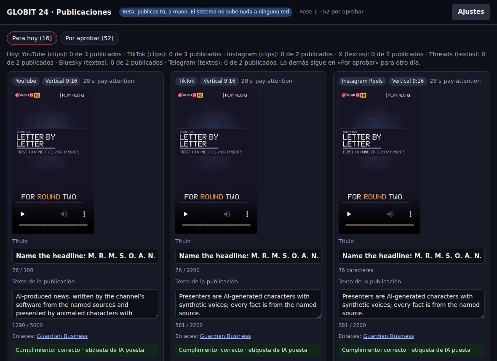
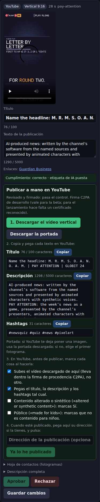

# La beta: publicar a mano

En la beta **no hay directo** y **el sistema no sube nada a ninguna red**. Cada día prepara unos pocos clips (y, si
quieres, textos), los revisa con el control de cumplimiento, los firma como hechos con IA y te los deja en la página
de aprobación. **Tú los publicas a mano** desde YouTube, TikTok e Instagram. ¿Por qué a mano? Porque las redes tardan
días o semanas en auditar las apps: hasta entonces, lo que sube YouTube por su API queda privado, y lo que sube TikTok
por la suya solo lo ves tú.

## Una sola vez, antes de empezar

1. **En el servidor**, en el archivo de variables (`/etc/globit24.env`), añade estas tres líneas (o pídeselo a quien
   te ayuda con el servidor):

       PUBLISH_MODE=manual
       EDITORIAL_CONTACT=el correo público donde te escriben
       EDITORIAL_RESPONSIBLE=tu nombre

   Sin `EDITORIAL_CONTACT` **no sale nada**: el control lo retiene todo, porque cada descripción tiene que decir quién
   responde del canal.
2. **La firma C2PA** (la etiqueta digital de «hecho con IA» que va dentro de cada vídeo):
   `~/globit/venv/bin/pip install -r tools/c2pa/requirements.txt` y, en el archivo de variables,
   `C2PA_PYTHON=/root/globit/venv/bin/python`. Para comprobarlo: `node tools/compliance/cli.mjs launch` no debe
   decir «C2PA SDK missing».
3. **La clave de IA, para las noticias** (la escribes tú en el archivo de variables, nunca en un chat):
   `ANTHROPIC_API_KEY=…`, `ANTHROPIC_MODEL=…` (el modelo que elegiste; te lo digo yo en el chat) y
   `PROVIDERS=anthropic,mock`. Con ella, el canal escribe las noticias con sus propias palabras y
   salen clips de ciencia, tecnología y deportes. Sin ella, solo sale el concurso, y el sistema te lo dice.
4. **Tus cuentas**: tu canal de YouTube, una cuenta de TikTok y una de Instagram. No hace falta ninguna app de
   desarrollador ni ninguna clave: publicas tú, desde la web o el móvil, como siempre.
5. **El canal sigue encendido** en el servidor (lee las noticias y guarda lo que cuenta), pero sin directo.
6. **Opcional, textos**: si quieres publicar también textos en X, Bluesky, Threads, Telegram o Facebook, en la página,
   **Ajustes**, pon esa red en «Manual».

## Cada día (unos 15–20 minutos)

1. **Por la noche, el servidor prepara el día**: `node tools/publish/beta.mjs hacer` (quien te ayuda puede dejarlo
   programado cada día hacia las 21:30). Con la clave de IA escribe las noticias del día con las del momento (ciencia,
   tecnología y, si hay resultados, deportes), les busca fotos con permiso de uso (las mismas que salen en antena, con
   su crédito; nunca una foto de un medio), les pone voz, rehace el concurso, graba cada programa, corta sus mejores
   momentos en vertical y lo deja todo esperando. Va despacio a propósito, para no quitarle fuerza al canal: cuenta
   con una o dos horas en un servidor de dos núcleos (al terminar dice cuánto tardó cada paso). Luego dice cuántas
   publicaciones hay para hoy y por qué se retiene lo demás. Ningún clip dura menos de 10 segundos.
2. **Abre la página**: en el servidor, `node tools/publish/beta.mjs`. Desde tu ordenador, abre antes el túnel
   `ssh -L 8740:127.0.0.1:8740 root@<tu servidor>` y luego, en el navegador, **http://127.0.0.1:8740/**.
3. **Pestaña «Para hoy»**: como mucho 3 clips para YouTube, 3 para TikTok y 2 para Instagram (lo demás espera a otro
   día). Mira cada vídeo. Si está bien, **Aprobar** (o **Aprobar en 3 redes**: el mismo clip en las tres). Si no,
   **Rechazar**.
4. En cada tarjeta aprobada, **Preparar para publicar**. El sistema lo revisa otra vez (que no copie al medio, que no
   haya una queja en el registro, que esté la etiqueta de IA) y firma el archivo. Si algo falla, la tarjeta pasa a
   «Retenido» con el motivo, y esa no se publica.
5. **Descargar el vídeo** (y la portada).
6. Abre la red, sube **ese** vídeo y, con los botones **Copiar**, pega el título (solo YouTube), la descripción y los
   hashtags tal cual.
7. Pon los interruptores de la red que dice la tarjeta, y márcalos uno a uno. **La etiqueta de IA de la red es
   obligatoria** (la tarjeta la pone la primera, después del archivo, y dice «Obligatorio»): desde el 18 de octubre el
   clip ya no lleva aviso en sus primeros segundos, así que esa etiqueta es lo primero que ve quien lo mira. Sin
   marcarla, «Ya lo he publicado» no funciona.
   - **YouTube**: contenido alterado o sintético («altered or synthetic content»): **Sí**. Público («made for kids»):
     **no es para niños**.
   - **TikTok**: la etiqueta de contenido generado por IA («AI-generated content»): **activada**. La privacidad la
     eliges tú (para la beta, todo el mundo). Contenido de marca: no.
   - **Instagram**: la etiqueta de IA («AI info»): **activada**.
   - **Facebook y Threads** (si algún día se usan): la etiqueta de IA («AI info») **a mano**, en cada vídeo.
8. Publica. Copia la dirección de la publicación, pégala en la tarjeta y pulsa **Ya lo he publicado**. Queda apuntado
   (en la cola y en el registro de cumplimiento) y no se te ofrecerá nunca otra vez.

**Un día de ejemplo, el 17 de octubre** (todavía sin la clave de IA): con el contacto puesto, «Para hoy» traía 8 clips,
todos del concurso (3 para YouTube, 3 para TikTok, 2 para Instagram). Ciencia y tecnología, nada: sin la clave las
escribe el redactor de reserva, que repite frases de los medios, y eso no se publica nunca. Con la clave, las escribe
la IA con sus propias palabras y entran en «Para hoy». Sin el contacto puesto, nada de nada.

**Las reglas no cambian**: lo retenido no se puede aprobar; en la fase 1 no se publica nada grave; la etiqueta de IA
va siempre; el mismo clip nunca sale dos veces en la misma red. Si cambias un título, se vuelve a revisar antes de
descargar. La carpeta `data/publish/factory/<día>` de días ya publicados se puede borrar pasada una semana.

## Qué bloquea hoy la beta y qué solo el lanzamiento

`node tools/compliance/cli.mjs launch` (17 de octubre, en la máquina de desarrollo) da cinco bloqueos. Ninguno se ha
rebajado; esto es lo que significa cada uno para una beta publicada a mano:

| Bloqueo | ¿Bloquea la beta? | Por qué |
|---|---|---|
| `EDITORIAL_CONTACT` sin poner (y `EDITORIAL_RESPONSIBLE`) | **Sí** | El control retiene cada publicación sin él. Lo pones tú (paso 1). |
| La firma C2PA con el certificado de desarrollo | No, solo el lanzamiento | Cada vídeo y portada salen firmados como hechos con IA y se leen de vuelta. Los validadores dirán «certificado no reconocido» (`compliance.md` §4: es lo esperado hasta tener uno de una autoridad de la lista C2PA, que es el bloqueo del lanzamiento). Por eso las etiquetas de cada red se ponen a mano (paso 7). **Pero en tu servidor el programa de firma tiene que estar instalado** (paso 2): sin él no se puede preparar nada. |
| `RIGHTS_GATE` no es estricto | No, solo el lanzamiento | Es para las fotos en el directo. Sin directo no se emite nada, y lo que se publica pasa siempre la regla estricta (un clip con una foto sin permiso no llega a la página). |
| Open-Meteo, plan de pago | No, solo el lanzamiento | La beta no publica ningún clip del tiempo (fuera de antena el tiempo es de prueba y nunca se publica). Ojo: hoy el canal llama a la API gratuita y no usa ninguna clave; poner `OPEN_METEO_API_KEY` quita el aviso, pero no cambia la llamada. |
| El redactor copia al medio (97 % de las últimas 300 noticias) | No la bloquea, la limita | Es el bloqueo del directo. En la beta, cada clip y cada texto pasa la regla uno a uno, y lo que copia (o lo que escribió el redactor de reserva) se retiene. Sin la clave de IA, solo sale el concurso. |

Además, para la beta: las preguntas al abogado (`compliance.md` §9) siguen abiertas, y una beta pública ya es
publicar. Los avisos (sin marca de agua de audio; el directo de YouTube) no afectan a la beta.

## Si algo va mal

- **«Para hoy» está vacío**: `node tools/publish/beta.mjs estado` dice por qué (casi siempre «Copia palabras del
  medio», o que el concurso no tenía bastantes noticias ese día).
- **`hacer` dice «Las noticias necesitan la clave de IA»**: falta la clave en el archivo de variables (paso 3 de arriba),
  o la IA no contestó (sin saldo, caída). Ese día solo sale el concurso.
- **«Preparar» dice que no pasa**: la tarjeta está en «Retenido» con el motivo. No la publiques.
- **Has publicado y se te olvidó pulsar «Ya lo he publicado»**: vuelve a la tarjeta (sigue en «Aprobado»), prepárala
  y púlsalo, con la dirección.
- **Alguien pide retirar algo**: retíralo en la red y apúntalo (`docs/publishing/compliance.md` §7). El registro ya
  sabe dónde lo publicaste.
